# Lab04 – SoC Zynq-7000

## Contenido

- Objetivos de aprendizaje
- Fundamento teórico
- Arquitectura del Zynq-7000
- Procedimiento
- Entregables
- Referencias

---

# 1. Objetivos de aprendizaje

Al finalizar esta práctica, el estudiante será capaz de:

- Implementar un **SoC** mediante la herramienta **Block Design** de Vivado.
- Identificar los bloques principales que componen el **Zynq-7000**.
- Comprender la integración entre procesador, memoria, periféricos y lógica programable.
- Reconocer la relación entre hardware programable y sistemas embebidos.
- Preparar una plataforma de hardware para su posterior desarrollo en **Vitis**.

---

# 2. Fundamento teórico

## 2.1 ¿Qué es un SoC?

Un **System on Chip (SoC)** es una arquitectura de hardware digital que integra, en un único circuito, los componentes esenciales de un sistema computacional. Generalmente incluye:

- Procesador central (**CPU**)
- Memoria ROM y RAM
- Periféricos de comunicación y control
- Temporizadores
- Interfaces de entrada y salida
- Buses internos de interconexión

El objetivo principal de un SoC es concentrar en un solo dispositivo las funciones necesarias para ejecutar aplicaciones completas, reduciendo el tamaño, el consumo y el costo.

---

## 2.2 SoC implementado en FPGA

En esta práctica, el sistema será implementado sobre una **Zybo Z7**, la cual incorpora un dispositivo **Zynq-7000**.

Esto permite trabajar con dos componentes principales dentro de una misma plataforma:

- **Processing System (PS):** procesador ARM y periféricos integrados.
- **Programmable Logic (PL):** lógica reconfigurable tipo FPGA.

Gracias a esto, es posible diseñar sistemas en los que una parte se ejecuta en software y otra se implementa en hardware.

---

# 3. Arquitectura del Zynq-7000

El **Zynq-7000** integra un procesador ARM Cortex-A9 junto con lógica programable Serie 7. Su arquitectura general se divide en dos grandes bloques:

## 3.1 Processing System (PS)

Corresponde al sistema de procesamiento embebido. Incluye:

- Procesador **ARM Cortex-A9**
- Memoria caché L1 y L2
- Controlador DDR
- Controladores SPI, I2C, UART, CAN, USB y Ethernet
- GPIO
- Temporizadores
- DMA
- JTAG y depuración

Este bloque permite ejecutar sistemas operativos o programas desarrollados, por ejemplo, en lenguaje C.

---

## 3.2 Programmable Logic (PL)

Corresponde a la sección FPGA reconfigurable. Incluye:

- LUTs
- Flip-Flops
- Bloques DSP
- Memoria BRAM
- Ruteo programable
- Interfaces de alta velocidad

Aquí se implementan aceleradores de hardware, periféricos personalizados o lógica digital diseñada por el usuario.

---

## 3.3 Comunicación entre PS y PL

Ambos bloques se comunican mediante buses **AXI**, lo que permite:

- Que el procesador controle hardware personalizado.
- Que módulos de hardware accedan a memoria.
- Crear sistemas embebidos de alto desempeño.

---

## 3.4 Recursos utilizados en esta práctica

Durante este laboratorio se emplearán los siguientes componentes:

- **ZYNQ7 Processing System**
- Memoria interna BRAM
- Interfaz AXI
- GPIO para botones y LEDs
- Reset del sistema
- Aplicación de software en Vitis

---

## Figura 1. Arquitectura general del Zynq-7000

---

# Observación técnica

En esta práctica se utilizará inicialmente el **Processing System** junto con periféricos básicos para comprender el flujo completo:

**Diseño de hardware en Vivado → Exportación → Desarrollo de software en Vitis**

# 4. Procedimiento

## 4.1 Integrar la Zybo Z7 al entorno de Vivado

1. Siga el paso a paso de la [siguiente página](https://digilent.com/reference/programmable-logic/guides/install-board-files?srsltid=AfmBOorC3OzN78uHx9FrXzecZKvcfOFIon4L6FowLLKsRxVVvsiouSiX).

Puede instalar únicamente los archivos correspondientes a la **Zybo Z7-10**.

## 4.2 Creación del SoC en Vivado

1. Cree un nuevo proyecto en Vivado como lo ha hecho para las entregas anteriores, con la diferencia de seleccionar la placa en lugar de elegir directamente la FPGA. Para ello, en la ventana `Default Part`, diríjase a la pestaña `Boards` y seleccione la tarjeta **Zybo Z7-10**, como se muestra en la siguiente imagen:

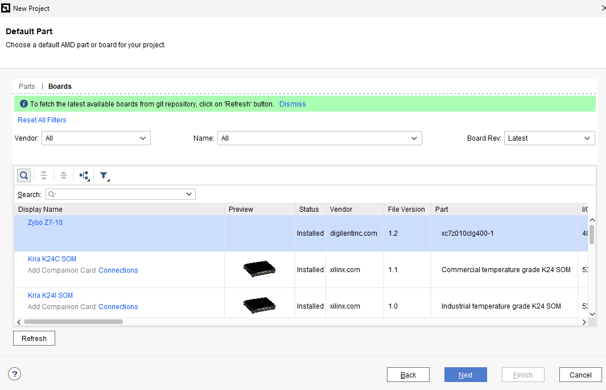

2. Después de crear el proyecto, en la interfaz de Vivado seleccione, en el menú de la izquierda y dentro de la categoría `IP INTEGRATOR`, la opción `Create Block Design`. Asigne un nombre al diseño y haga clic en `OK`.

3. En la ventana `Diagram`, seleccione el ícono `+` y añada, uno a uno, los siguientes bloques:

ZYNQ7 Processing System  
Processor System Reset  
AXI Interconnect  
AXI BRAM Controller  
Block Memory Generator  

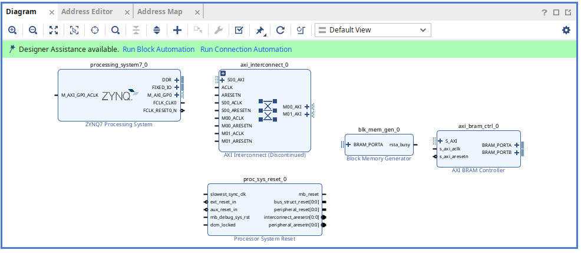

4. Realice las conexiones como se muestra en la siguiente imagen:

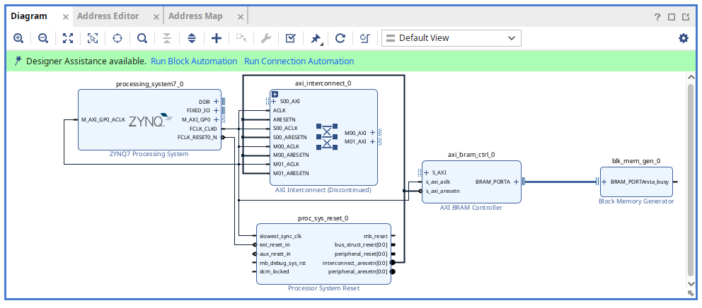

5. Incluya los GPIO de los LEDs y los botones. Para ello, en la ventana ubicada a la izquierda del diagrama, seleccione la pestaña `Board` y añada los GPIO `4 Buttons` y `4 LEDs`, haciendo doble clic sobre cada uno y aceptando el cuadro de diálogo correspondiente.

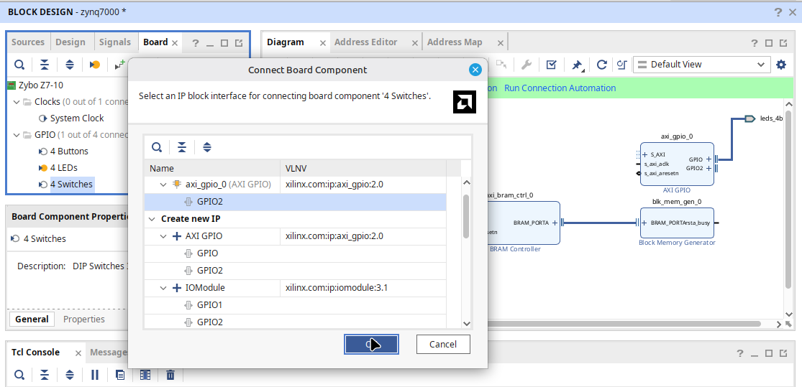

6. Realice las conexiones de `clk`, `rst` y `AXI` del nuevo bloque. Posteriormente, haga clic derecho sobre un espacio vacío de la ventana `Diagram` y seleccione `Regenerate Layout`. Su diagrama de bloques debe verse de manera similar al mostrado en la siguiente imagen:

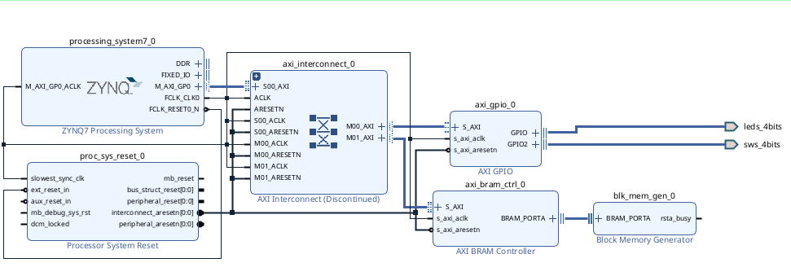

7. En la ventana `Diagram`, diríjase a la pestaña `Address Editor`. Haga clic derecho sobre un espacio vacío y seleccione `Assign`. Posteriormente, cambie el rango de memoria de 64K a 4K para `/axi_gpio_0/S_AXI`.

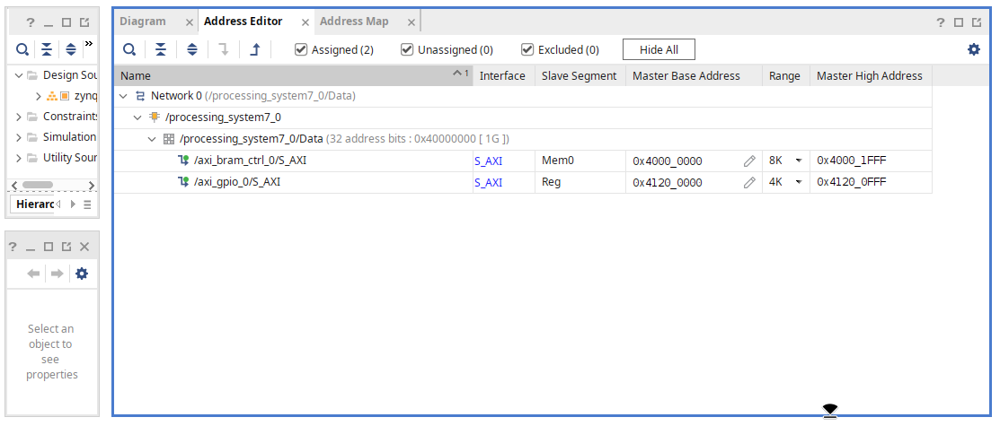

8. Regrese a la pestaña `Diagram`. En la ventana `Sources`, ubicada a la izquierda, seleccione la fuente correspondiente al diseño de bloques, que para el caso de la imagen se denomina `Zynq 7000`. Haga clic derecho sobre esta y seleccione `Create HDL Wrapper`. En la ventana que aparece, seleccione la opción `Let Vivado manage wrapper and auto-update` y haga clic en `OK`.

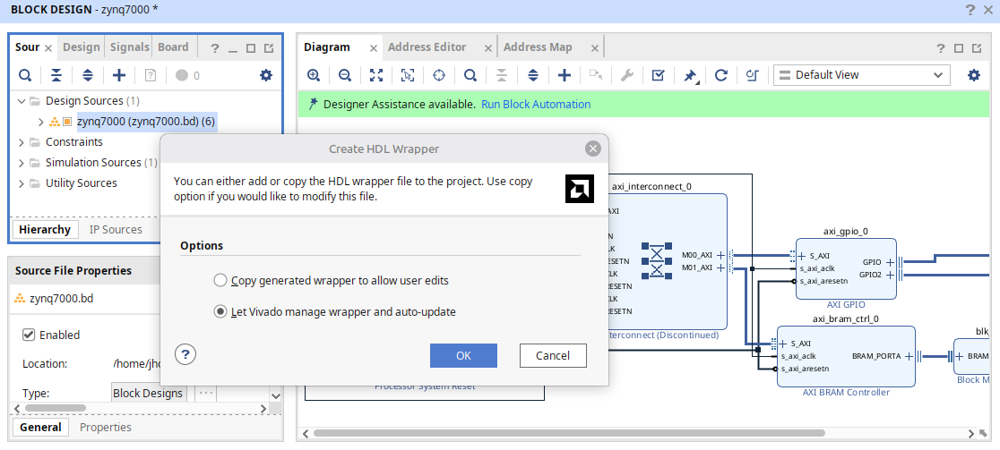

9. Después de generar el `Wrapper`, regrese a la ventana del diagrama. En la parte superior encontrará la opción `Run Block Automation`. Haga clic sobre ella y, en la ventana de diálogo que aparece, seleccione `OK`.

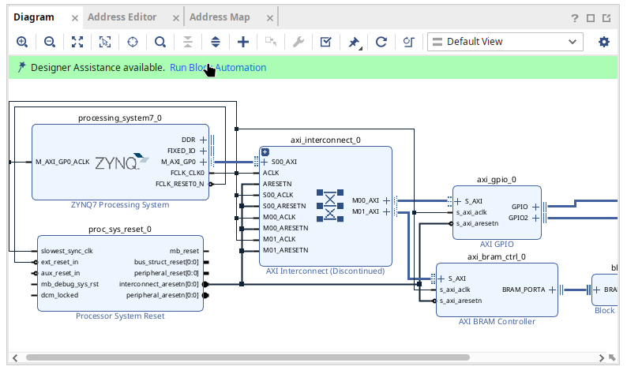

10. Genere el `Bitstream` como lo ha hecho en los laboratorios anteriores.

11. Una vez generado el `Bitstream`, diríjase a `File → Export → Export Hardware`. En la ventana `Export Hardware Platform`, haga clic en `Next`. Posteriormente, seleccione la opción correspondiente a incluir el bitstream y continúe con `Next` hasta finalizar el proceso con `Finish`.

Con esta acción se generará el archivo `XSA`, el cual será necesario posteriormente en el entorno de Vitis.

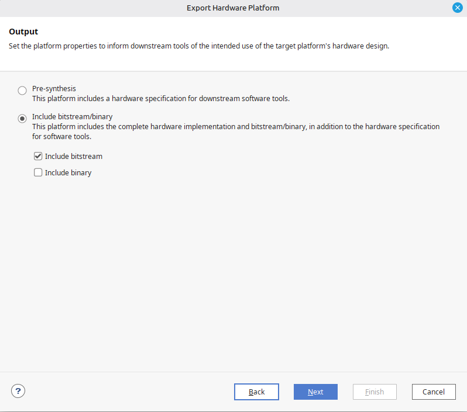

## 4.3 Entorno de Vitis

Vitis es un entorno de desarrollo utilizado para crear aplicaciones destinadas a dispositivos de hardware adaptable de AMD, como los SoC y las FPGA. Trabaja en conjunto con herramientas de diseño de hardware como Vivado, permitiendo desarrollar el software que será ejecutado sobre la plataforma de hardware previamente definida.

Para continuar con el proyecto en Vitis, siga los siguientes pasos:

1. Abra el entorno de Vitis. Para ello, desde Vivado, diríjase a `Tools → Launch Vitis IDE`.

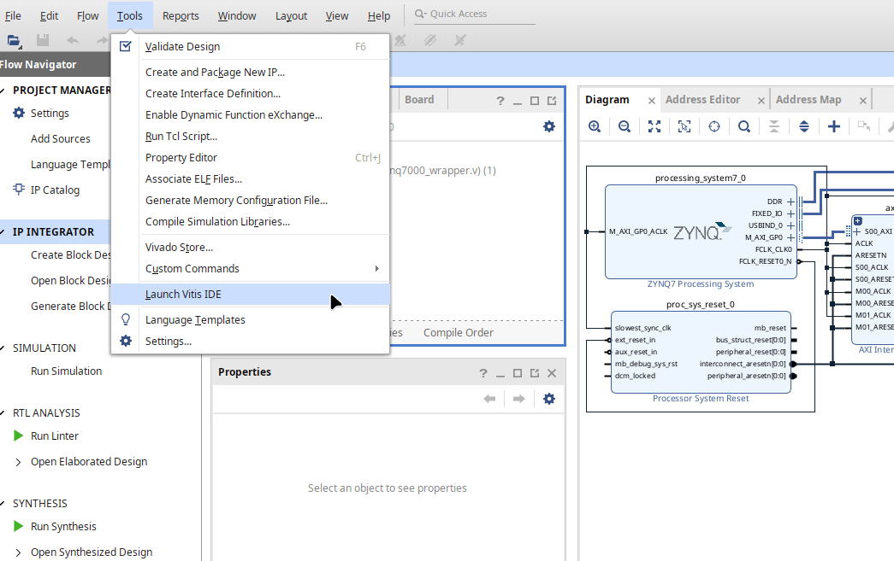

2. En la ventana principal de Vitis, haga clic en `Set Workspace` y seleccione la ubicación donde desea crear la aplicación.

3. Haga clic en `Create Platform Component`. En la ventana `Name and Location`, escriba un nombre para la plataforma en la casilla `Component name` y haga clic en `Next`.

En la pestaña `Flow`, seleccione la opción `Hardware Design`. Posteriormente, haga clic en `Browse`, busque y seleccione el archivo `XSA` generado previamente en Vivado y haga clic en `Next`.

En la ventana `OS and Processor`, seleccione las opciones mostradas en la siguiente imagen y haga clic en `Next`. Finalmente, en la pestaña `Summary`, haga clic en `Finish`.

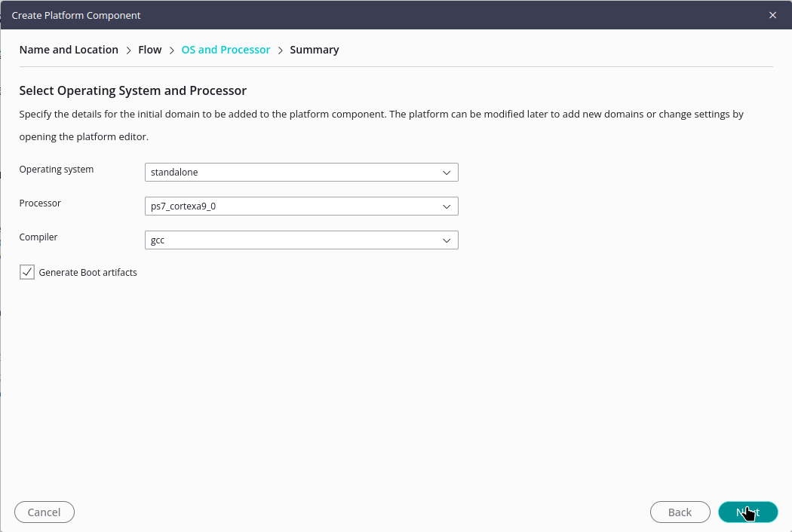

4. En la ventana ubicada a la izquierda, seleccione la plataforma que acaba de crear. Posteriormente, en la parte superior, seleccione el ícono `+` y la opción `Application`.

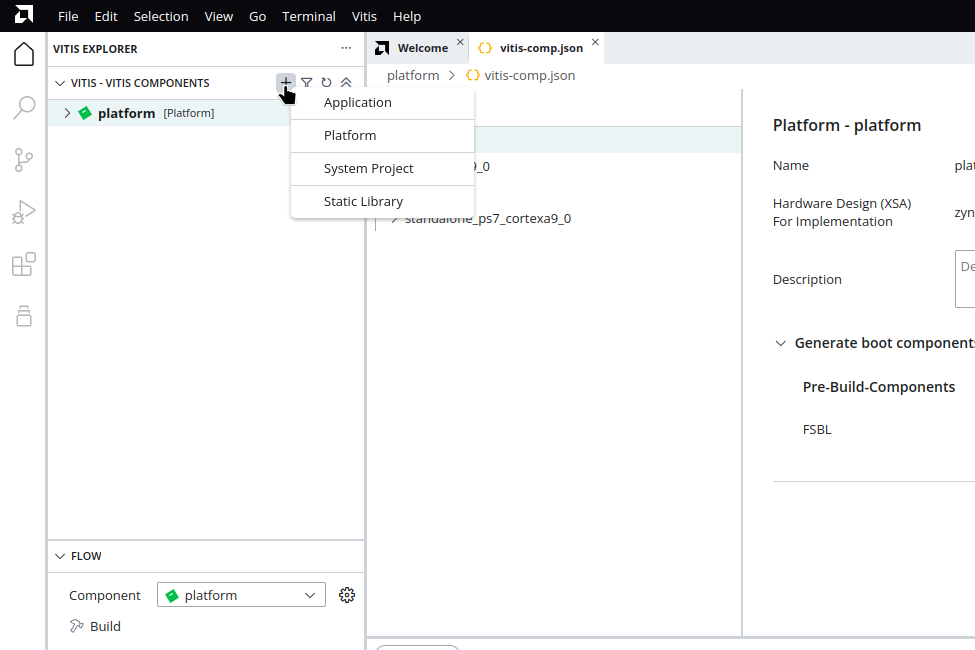

5. En la ventana `Create Application Component - Empty Application`, en la pestaña `Component name`, elija un nombre para la aplicación y haga clic en `Next`.

En la pestaña `Hardware`, seleccione la plataforma creada en el paso 3 y haga clic en `Next`.

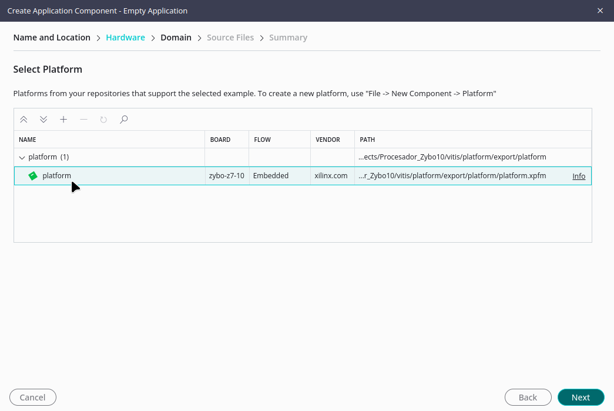

6. En la pestaña `Domain`, asegúrese de que esté seleccionado el dominio creado por defecto junto con la plataforma y haga clic en `Next`.

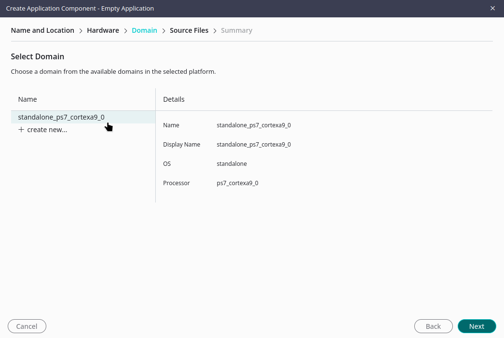

7. En la pestaña `Add Source Files`, añada el archivo `main.c` que se encuentra en la carpeta `src`.

8. En la pestaña `Summary`, revise la información mostrada y verifique que las opciones seleccionadas sean correctas. Haga clic en `Finish`.

9. En la ventana `FLOW`, ubicada a la izquierda, haga clic en `Build`. Si el proyecto se construye sin errores, conecte la FPGA y haga clic en `RUN`.

Deberá observar que los LEDs de la Zybo parpadean. Además, al mantener presionado alguno de los botones, el LED correspondiente permanecerá encendido mientras el botón continúe pulsado.

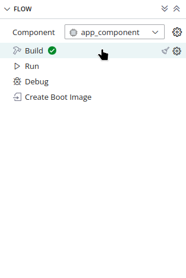

# 5. Entregables

1. Realice cada uno de los pasos descritos y muestre las respectivas evidencias durante la clase y en el archivo `README.md`.

2. Adjunte las evidencias en su respectivo repositorio de GitHub Classroom.

# 6. Referencias

- [FPGAs for Beginners. (2023, 28 julio). Zynq Part 1: Vivado block diagram (no Verilog/VHDL necessary!). YouTube.](https://www.youtube.com/watch?v=UZ3FnZNlcWk)

- [SoC AMD Zynq™ 7000. (s. f.). AMD](https://www.amd.com/es/products/adaptive-socs-and-fpgas/soc/zynq-7000.html)